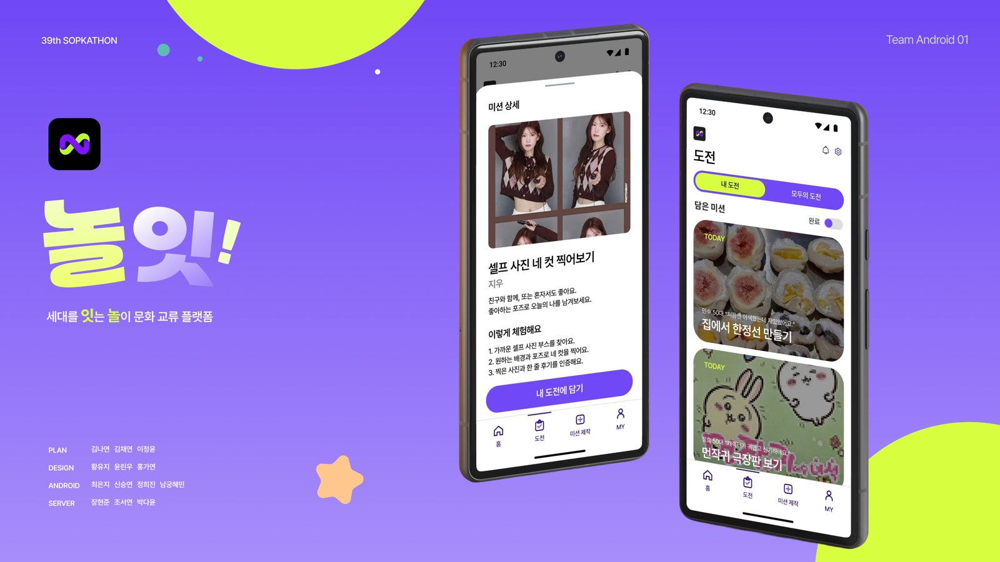
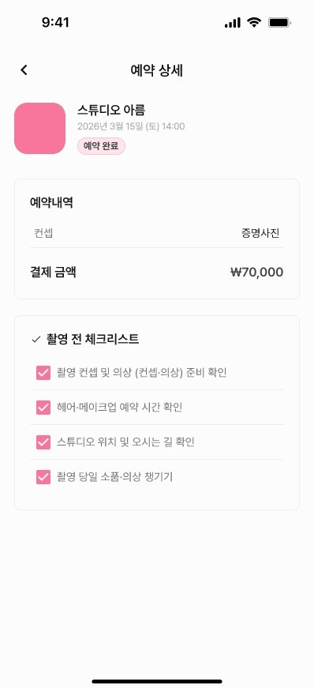

# 🤖 Shin Seungyeon — Android × Web 🤖

<!-- 바로가기 -->

## 🫐 About Me

동국대학교 정보통신공학과 3학년 신승연입니다.  
UMC 10기에서 **React**로 웹 프론트엔드를 처음 시작했고, 이번 학기에는 UMC 11기에서 **Spring Boot**로 서버를, SOPT에서 **Kotlin · Jetpack Compose**로 Android 개발을 하고 있습니다.  
API 명세와 실제 응답을 꼼꼼히 맞춰 보고, 코드 리뷰로 팀과 기준을 맞추는 과정을 좋아합니다.

## 🌱 Activities

- **PLAY SOPT 39기 Android 파트** (2026.10 - 현재): 매주 과제를 Issue · Branch · PR로 제출하고 OB · YB 코드 리뷰를 주고받으며 팀 기준 맞추기
- **UMC 동국대 11기 운영진 · Web / Spring** (2026.09 - 현재) · **UMC 10기 Web 파트 수료** (2026.03 - 2026.08)
- **정보통신공학과 학생회 홍보부국장** (2026.02 - 현재)
- **Farm System 3기 IoT 트랙** (2024.05 - 2024.12): EGEE LAB 이지랩 메이커톤 참여

## 🍽️ Projects

- **캐치테이블 리디자인 (SOPT 39기 합동세미나 · Android)**: 친구와 함께 식당을 고르는 **'함께 고르기' 투표 기능**을 더한 예약 앱 리디자인입니다. 홈 화면과 하단 내비 · 탭바 공통 컴포넌트를 만들고, 진행 중인 투표 조회 API를 **Dto → Mapper → Repository → UseCase → ViewModel**로 계층 분리해 연동했습니다. 화면 복귀 시(`ON_RESUME`) 재조회해 투표 상태가 항상 최신으로 보이도록 했습니다.  
  기술: Kotlin, Jetpack Compose, Retrofit, Hilt, Coil | [GitHub](https://github.com/SOPT-all/39-COLLABORATION-ANDROID-CATCHTABLE)

  

    
  

  

    &nbsp;&nbsp;
    
     내가 맡은 홈 화면 (기본 · 진행 중인 투표 있을 때)
  

- **놀잇 (SOPT 39기 솝커톤 · 1박 2일)**: 세대를 잇는 놀이 문화 교류 앱입니다. CompositionLocal 기반 **디자인 시스템**(Color · Typography 11종)과 공통 컴포넌트를 만들고, 마이페이지에서 실패 응답의 **에러 code별로 안내 문구를 나누는** Loading · Success · Error 흐름을 구현했습니다.  
  기술: Kotlin, Jetpack Compose, Retrofit, Hilt | [GitHub](https://github.com/SOPT-all/39-SOPKATHON-ANDROID-ANDROID1)

  

    
  

- **UMCine (UMC 11기 · Web / Spring)**: 회원가입 · 로그인 후 영화에 평점을 남기는 서비스입니다. 평점 CRUD REST API와 **JWT 인증 · 인가**를 구현해 남의 평점 수정은 403으로 막고, H2 통합 테스트 7개와 Postman으로 검증한 뒤 React 화면과 직접 연결했습니다.  
  기술: Java 21, Spring Boot, JPA, MySQL, React, TypeScript | [GitHub](https://github.com/DGU-UMC-11th/PE-Web-B)

- **PICDAY (UMC 10기 데모데이)**: 조건에 맞는 사진관을 찾고 예약 · 리뷰를 관리하는 서비스입니다. 마이페이지의 **예약 상세 · 취소 · 재예약**, 0.5점 단위 리뷰 작성, 프로필 수정 · 중복 확인을 맡고 공통 컴포넌트를 분리했습니다.  
  기술: React, TypeScript, Vite, Tailwind CSS, Zustand, TanStack Query | [GitHub](https://github.com/UMC-PICDAY/PICDAY_FE)

  

    
     내가 맡은 마이페이지 예약 상세 화면
  

- **모바일소프트웨어 Android 앱 (전공 수업)**: 코루틴 · Retrofit · Coil로 서버 사진을 그리드로 보여주는 **사진 그리드 앱**(단위 테스트 6개)과, 600 / 840dp 기준으로 1-pane ↔ 2-pane이 바뀌는 **적응형 할 일 앱**(단위 14개 · UI 테스트 4개)을 만들었습니다.  
  기술: Kotlin, Jetpack Compose, Coroutine, Retrofit, Coil, ViewModel, StateFlow

## 🐝 Tech Stack

### Android

### Frontend

### Backend & Languages

### Tools

## 😸 승구리

## 🐘🧡 donggukgirls

## 💌 Contact me
- 이메일: syshin0608@gmail.com
- GitHub: https://github.com/shinisme
